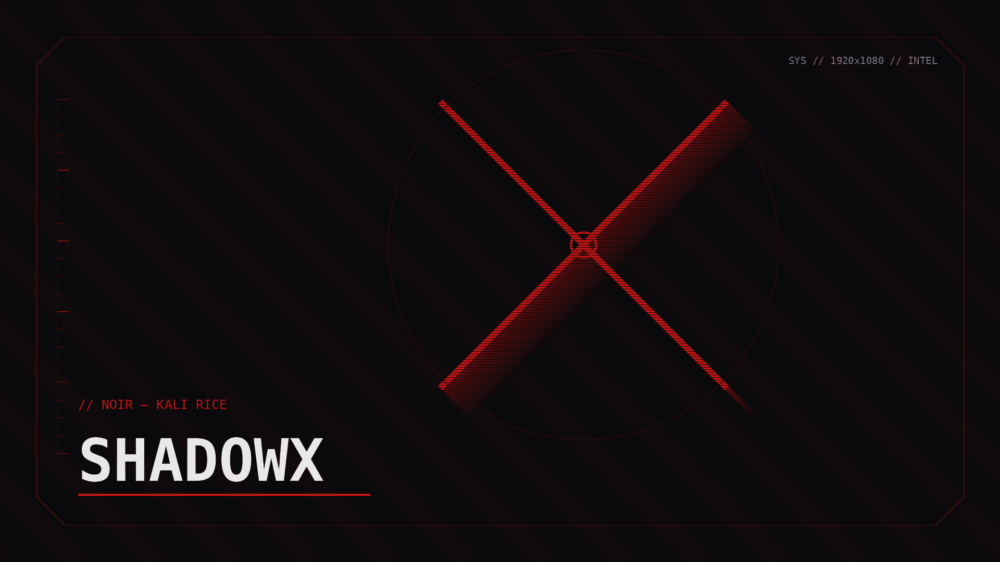
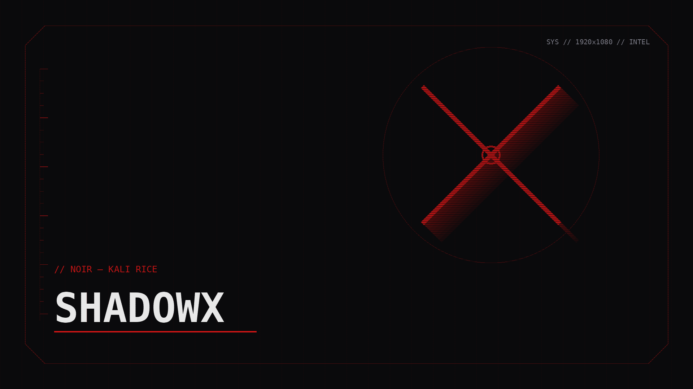

# SHADOWX // NOIR

<p align="center">
  
</p>

<p align="center">
  <b>SHADOWX // NOIR</b> — an original desktop rice for Kali Linux.
  Charcoal black <code>#0a0a0c</code> · signal red <code>#cc1515</code> ·
  built for a 1920×1080 laptop with Intel integrated graphics.
</p>

---

## Gallery

| Main wallpaper | Alternate wallpaper |
|---|---|
|  |  |

Both wallpapers are generated locally by [`generate-wallpaper.py`](generate-wallpaper.py).

---

## Contents

- [Install](#install)
- [What's inside](#whats-inside)
- [Keybindings](#keybindings)
- [Customization](#customization)
- [Intel iGPU notes](#intel-igpu-notes)
- [Project structure](#project-structure)

---

## Install

```bash
git clone <this-repo-url>
cd shadowx-noir
bash install.sh
```

The installer:

1. Installs the required packages with `apt`
2. Backs up existing configs to `~/.config-backup-shadowx-<timestamp>`
3. Deploys the dotfiles into `~/.config`
4. Installs both wallpapers into `~/Pictures/shadowx-wallpapers`
5. Sets `shadowx-void.png` as the boot wallpaper

After it finishes, **log out** and select **Hyprland** at the login screen.

> If Hyprland does not appear in your login menu, log in on a TTY
> (`Ctrl+Alt+F3`) and run `Hyprland` manually.

---

## What's inside

| Role | Program | Config location |
|---|---|---|
| Compositor | Hyprland | `~/.config/hypr/` |
| Status bar | Waybar (bottom rail) | `~/.config/waybar/` |
| App menu / window switch | rofi | `~/.config/rofi/shadowx.rasi` |
| Terminal | Kitty | `~/.config/kitty/kitty.conf` |
| Terminal banner | Fastfetch | `~/.config/kitty/fastfetch.jsonc` |
| System monitor | btop | `~/.config/btop/` |
| Lock / idle | swaylock + swayidle | `~/.config/swaylock/` |
| Notifications | dunst | `~/.config/dunst/dunstrc` |
| Wallpaper | swaybg + rofi picker | `~/.config/scripts/wallpaper.sh` |
| Media | mpv | `~/.config/mpv/mpv.conf` |
| Power menu | rofi + systemctl | `~/.config/scripts/power-menu.sh` |
| Shell | Bash | `~/.bashrc` |

---

## Keybindings

| Keys | Action |
|---|---|
| `SUPER + Space` | Application menu |
| `SUPER + Tab` | Window switcher |
| `SUPER + T` / `SUPER + Enter` | Kitty terminal |
| `SUPER + 1` … `SUPER + 5` | Switch workspace |
| `SUPER + Q` | Close active window |
| `SUPER + L` | Lock screen |
| `SUPER + P` | Wallpaper picker |
| `SUPER + M` | Open mpv |
| `SUPER + R` | Reload Hyprland |
| `SUPER + Escape` | Exit Hyprland |
| `ALT + Tab` | Cycle windows |
| `ALT + SHIFT + S` | Area screenshot → file + clipboard |
| Volume / brightness keys | pactl / brightnessctl |

Click the **power icon** at the bottom-right of the bar for
Lock / Logout / Suspend / Reboot / Shutdown.

---

## Customization

- **Monitor, scaling, keybindings:** `~/.config/hypr/user.conf`
  (this file is preserved by the installer)
- **Colors:** `~/.config/waybar/style.css`, `~/.config/kitty/kitty.conf`,
  `~/.config/rofi/shadowx.rasi`, `~/.config/btop/themes/shadowx.theme`
- **Wallpapers:** `~/Pictures/shadowx-wallpapers/`
- **Regenerate wallpapers:** `python3 generate-wallpaper.py`
- **Shell overrides:** `~/.bashrc.local`

---

## Intel iGPU notes

- Blur is disabled in `hyprland.conf` to keep composition light.
- If video tears, uncomment `env = LIBVA_DRIVER_NAME, iHD` in `user.conf`.
- If the session feels heavy, set `animations { enabled = false }` in
  `hyprland.conf`.
- To confirm your display name, run `hyprctl monitors` and update the
  `monitor = eDP-1, 1920x1080@60, 0x0, 1` line in `user.conf`.

---

## Project structure

```
shadowx-noir/
├── README.md
├── install.sh
├── generate-wallpaper.py
├── assets/
│   └── wallpapers/
│       ├── shadowx-void.png
│       └── shadowx-grid.png
└── config/
    ├── hypr/        # hyprland.conf + user.conf
    ├── waybar/      # config.jsonc + style.css
    ├── kitty/       # kitty.conf + fastfetch.jsonc
    ├── btop/        # btop.conf + shadowx.theme
    ├── rofi/        # shadowx.rasi
    ├── dunst/       # dunstrc
    ├── swaylock/    # config
    ├── mpv/         # mpv.conf
    ├── scripts/     # wallpaper, screenshot, lock, power-menu
    └── bash/        # .bashrc
```
