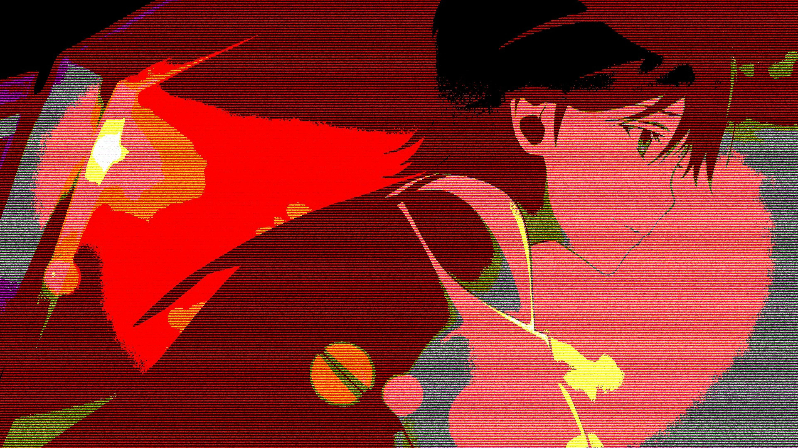
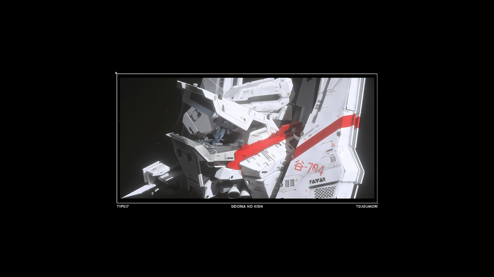

# SHADOWX // NOIR

A **complete Kali Linux / Debian port** of the Knights of Sidonia–inspired
Tsugumori rice — rebuilt for your laptop with **your XFCE keybindings**,
**your wallpaper**, and **your existing Ghostty terminal**.

- Base: charcoal `#0a0a0a` · accent `#cc1515` · text `#e8e8e8`
- Display: 1920×1080 · Intel iGPU (blur off, light effects)
- Desktop: Hyprland + Waybar + rofi + dunst + swaylock

---

## Wallpapers

| Your custom wallpaper | Original Sidonia wallpaper |
|---|---|
|  |  |

All wallpapers from the original (`Aleph1–4`) plus your custom one are installed
to `~/Pictures/shadowx-wallpapers/`. Press `SUPER + P` to pick one.

---

## What's included (full feature set)

| Original feature | Kali port |
|---|---|
| Hyprland workspace / animations | Hyprland 0.56 classic config with custom bezier animations |
| NieR-style Control Center | `control-center.sh` (rofi): Wi-Fi, Bluetooth, volume, brightness, notifications, quickshare, power |
| App menu & launcher | rofi `drun` / `run` with matching SID0NIA theme |
| Quickshell lock screen | swaylock + generated login background (live clock, date, `shadowx`, red ring) |
| Notifications | dunst, themed red/charcoal |
| Media player panel | `player.sh` (playerctl + rofi) |
| Quick notes drawer | `notes.sh` — autosaving notes with rofi |
| Clipboard history | `clipboard.sh` (cliphist + rofi) |
| Quickshare | `quickshare.py` — LAN file sharing with QR code |
| Wallpaper picker | `wallpaper.sh` (rofi) + swaybg daemon |
| Waybar | original Waybar config + style, with extra module buttons |
| Terminal | **Ghostty** (your existing config, never overwritten) |
| Fastfetch / btop | original layouts and palettes, rebranded |
| Fonts | IBM Plex Mono + Share Tech Mono from the original repo |
| Screenshots | region / window / full via grim + slurp + wl-copy |
| Lock idle / DPMS | swayidle (5 min lock, 10 min screen off) |

---

## Install

```bash
cd shadowx-complete
bash install.sh
```

Press **Y** for backups and **Y** for the themed `.bashrc`, then enter your
password. The installer:

1. installs all packages with `apt`
2. backs up existing configs to `~/.config-backup-shadowx-<timestamp>`
3. deploys configs to `~/.config`
4. installs wallpapers + fonts
5. creates `/etc/pam.d/swaylock` (so your password works on the lock screen)
6. installs a session wrapper that waits for logind to mark the session active
   (this is what makes mouse/keyboard work reliably) and sets
   **SHADOWX // NOIR** as the default login session
7. verifies the Hyprland config

Then **log out** and **log back in** — you'll land directly in the rice.

---

## Keybindings (your XFCE shortcuts, preserved)

| Keys | Action |
|---|---|
| `Alt+F1` / `Alt+F3` / `Ctrl+Esc` / `Super+Space` | App menu |
| `Alt+F2` / `Super+R` | Run dialog |
| `Ctrl+Alt+T` / `Super+T` / `Super+Enter` | Ghostty |
| `Ctrl+Alt+F` / `Super+E` / `Super+F` | Files |
| `Super+W` / `XF86WWW` / `XF86HomePage` | Browser |
| `XF86Calculator` | Calculator |
| `Ctrl+Alt+Esc` / `Alt+F4` / `Super+Q` | Close window |
| `Alt+F11` / `Super+F` | Fullscreen |
| `Super+D` | Maximized |
| `Super+V` | Floating |
| `Alt+Tab` / `Alt+Shift+Tab` | Cycle windows |
| `Super+1…9` | Workspace |
| `Alt+1…7` | Move window to workspace |
| `Super+Arrows` / `Super+Shift+Arrows` | Focus / move window |
| `Super+scroll` | Next/previous workspace |
| `Super+drag` / `Super+right-drag` | Move / resize window |
| `Print` + all your variants | Screenshot → file + clipboard |
| `Ctrl+Shift+Esc` | Task manager (btop) |
| `Ctrl+Alt+L` / `Super+L` | Lock screen |
| `Ctrl+Alt+Delete` | Power menu |
| `Super+Tab` | Control Center |
| `Super+N` | Quick notes |
| `Super+C` | Clipboard history |
| `Super+Shift+Return` | Media player |
| `Super+P` | Wallpaper picker |
| `Super+Alt+R` | Reload Hyprland |
| `Super+Escape` | Exit Hyprland |
| Volume / brightness keys | pactl / brightnessctl |

---

## Customize

- **Monitor, keys, overrides:** `~/.config/hypr/user.conf` (preserved)
- **Colors:** `~/.config/waybar/style.css`, `~/.config/rofi/sidonia.rasi`,
  `~/.config/dunst/dunstrc`, `~/.config/btop/themes/shadowx.theme`
- **Lock username:** `USER = "shadowx"` in `~/.config/scripts/lock-bg.py`
- **Notes / clipboard data:** `~/.local/share/shadowx/`
- **Shell overrides:** `~/.bashrc.local`
- **Input check:** `bash ~/.config/scripts/check-input.sh`

## Intel iGPU notes

Blur and shadows are off. If video tears, uncomment
`env = LIBVA_DRIVER_NAME, iHD` in `user.conf`.

## Structure

```
shadowx-complete/
├── install.sh
├── assets/
│   ├── wallpapers/      # Aleph1-4 + shadowx-custom.jpg
│   └── fonts/           # Share Tech Mono + IBM Plex Mono
└── config/
    ├── hypr/            # hyprland.conf + user.conf
    ├── waybar/          # config.jsonc + style.css
    ├── rofi/            # sidonia.rasi
    ├── dunst/           # dunstrc
    ├── swaylock/        # login screen
    ├── scripts/         # control center, notes, clipboard, player, quickshare, etc.
    ├── session/         # display-manager wrapper + desktop entry
    ├── fastfetch/ btop/ # original layouts rebranded
    └── .bashrc
```

Base theme inspired by [Tsugumori](https://github.com/Aleph1-9012/Tsugumori.git).
Rebuilt from scratch for Kali Linux.
