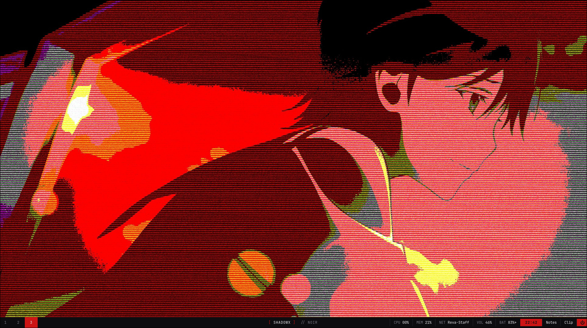
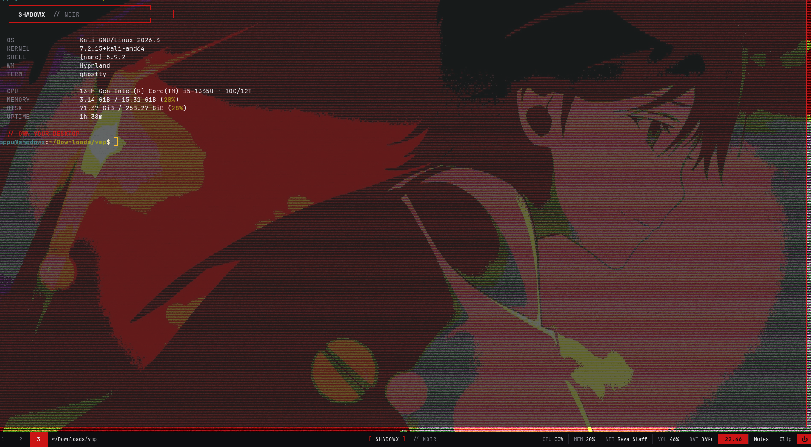
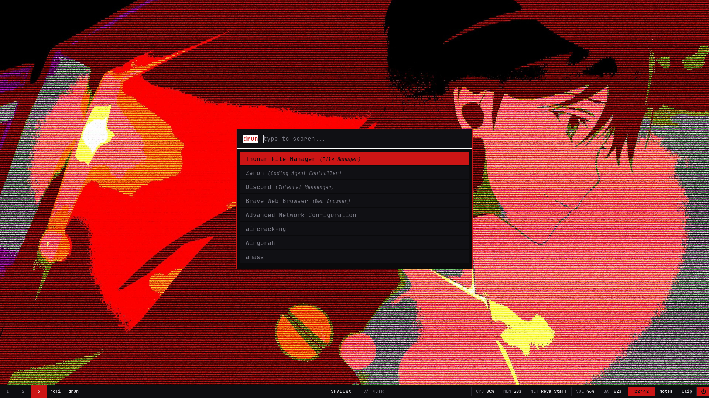

# SHADOWX // NOIR

My own desktop rice for Kali Linux — **written from scratch**, not copied from
anyone else's config. Your shortcuts, your wallpaper, your Ghostty terminal.

- Charcoal `#0a0a0c` · red `#cc1515` · off-white `#e8e8ec`
- 1920×1080 laptop · Intel iGPU (blur disabled)
- Hyprland (native **Lua** config) + Waybar + rofi + dunst

## ⭐ Use the XFCE edition (recommended)

Hyprland 0.56.2 on this Kali build has a bug where no input devices are
registered, so mouse and keyboard don't work. The same look is applied to
**XFCE**, where everything works. From the extracted folder run:

```bash
bash config/xfce/setup.sh
```

That sets the wallpaper, `Kali-Red-Dark` GTK theme, JetBrains Mono font,
charcoal bottom panel, your shortcuts, and installs a rofi wallpaper picker.

At the login screen pick **XFCE** (it's the default).

## Wallpaper


Only one wallpaper — yours. It becomes both the desktop background and the
login-screen background. `Super+P` reapplies it.

## Screenshots

Real screenshots from the running rice.

| Desktop | Terminal (Ghostty) |
|---|---|
|  |  |

| App launcher | SHADOWX menu |
|---|---|
|  |  |

### Logout / power screen


## Features

| Feature | How |
|---|---|
| App menu / run dialog | rofi with my `shadowx.rasi` theme |
| Control center | Wi-Fi, Bluetooth, volume, brightness, notifications, quickshare, power |
| Quick notes | `notes.sh` — autosaving notes |
| Clipboard history | `clipboard.sh` via cliphist |
| Media controls | `player.sh` via playerctl |
| Quickshare | `quickshare.py` — LAN sharing with QR |
| Status bar | Waybar, bottom rail |
| Terminal | Ghostty (your config, untouched) |
| Fastfetch / btop | custom layouts and palettes |
| Screenshots | region / window / fullscreen via grim + slurp |

## Install

```bash
cd shadowx-original
bash install.sh
```

Answer **Y** to backups, press Enter for prompts, enter your password.

Then **log out** and **log back in** — SHADOWX // NOIR is the default session.

## Shortcuts (yours, preserved)

| Keys | Action |
|---|---|
| `Alt+F1` / `Alt+F3` / `Ctrl+Esc` / `Super+Space` | App menu |
| `Alt+F2` / `Super+R` | Run dialog |
| `Ctrl+Alt+T` / `Super+T` / `Super+Enter` | Ghostty |
| `Ctrl+Alt+F` / `Super+E` / `Super+F` | Files |
| `Super+W` | Browser |
| `Ctrl+Alt+Esc` / `Alt+F4` / `Super+Q` | Close window |
| `Alt+F11` / `Super+F` | Fullscreen |
| `Super+D` | Maximized · `Super+V` floating |
| `Alt+Tab` / `Alt+Shift+Tab` | Cycle windows |
| `Super+1…9` | Workspace · `Alt+1…7` move window |
| `Super+Arrows` / `Super+Shift+Arrows` | Focus / move window |
| `Print` + variants | Screenshot → file + clipboard |
| `Ctrl+Shift+Esc` | btop task manager |
| `Ctrl+Alt+Delete` | Logout / power menu |
| `Super+Tab` | Control center · `Super+N` notes · `Super+C` clipboard |
| `Super+Shift+Return` | Player · `Super+M` mpv |
| `Super+P` | Wallpaper · `Super+Alt+R` reload · `Super+Escape` exit |

## Customize

- Monitor / overrides: `~/.config/hypr/user.conf`
- Colors: `~/.config/waybar/style.css`, `~/.config/rofi/shadowx.rasi`,
  `~/.config/dunst/dunstrc`, `~/.config/btop/themes/shadowx.theme`
- Input check: `bash ~/.config/scripts/check-input.sh`

## Structure

```
shadowx-original/
├── install.sh
├── assets/wallpapers/shadowx.jpg
└── config/
    ├── hypr/ waybar/ rofi/ dunst/
    ├── scripts/     # control center, notes, clipboard, player, wallpaper, etc.
    ├── session/     # login-session wrapper
    ├── fastfetch/ btop/
    └── bash/
```
